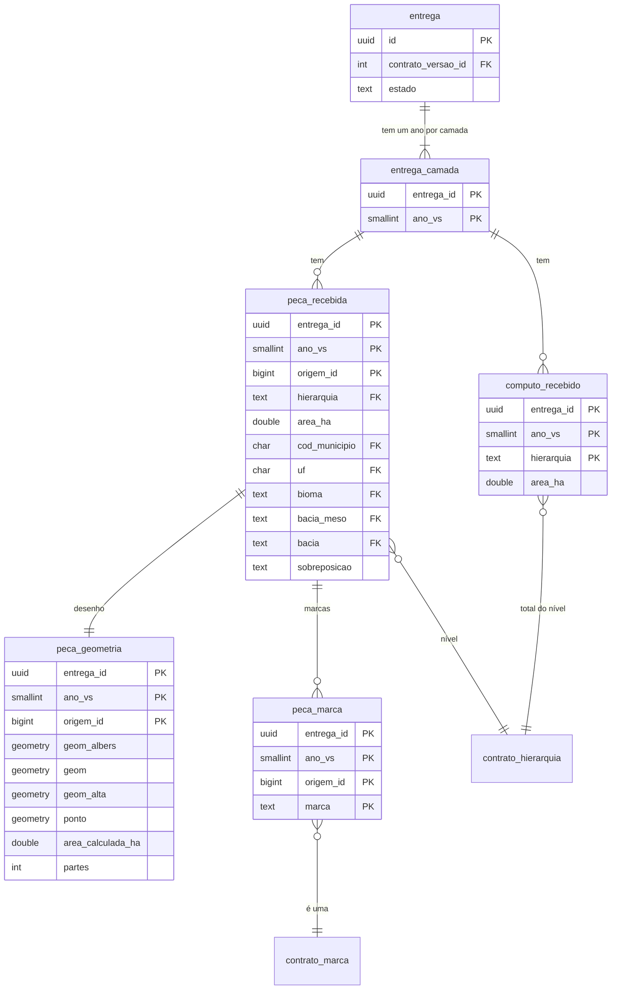
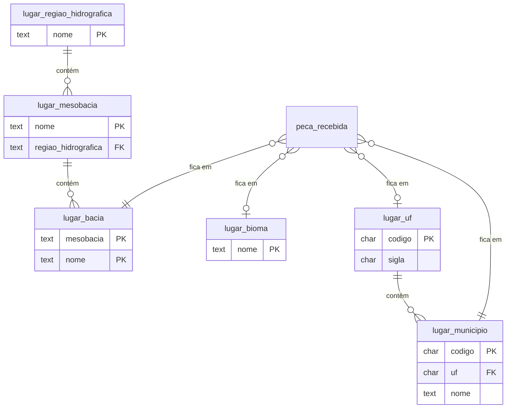
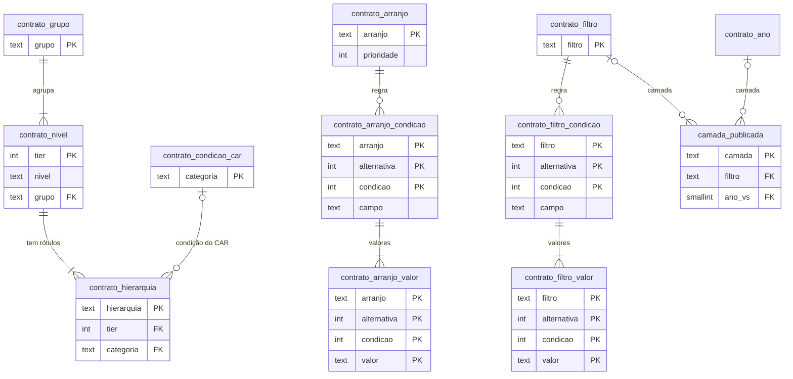
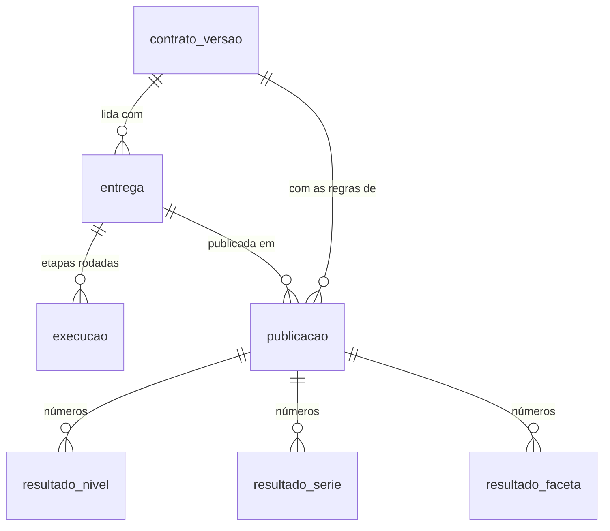
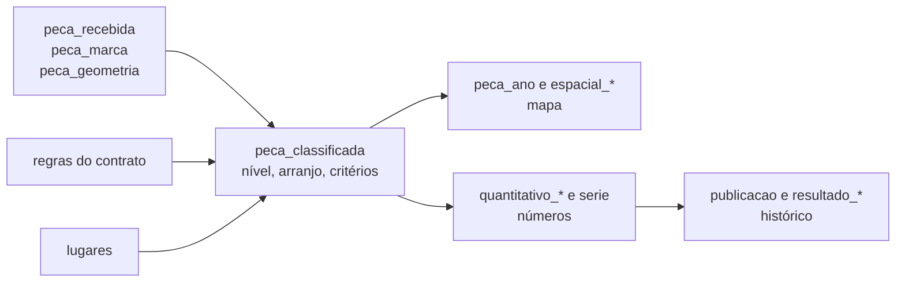

# Perguntas sobre a modelagem

Respostas curtas para quem abre o banco pela primeira vez: o que tem em cada tabela e view, e como
cortar a vegetação secundária (VS) por critério e por lugar. Como criar o banco está no
[README](README.md). O porquê de cada escolha está no [resumo do código](../docs/resumo-do-codigo.md#parte-1-a-modelagem).

## A estrutura

### Que tabelas existem?

São 36, todas em `public`, em [`1_tabelas.sql`](1_tabelas.sql).

| Grupo | Tabelas | Para que |
| --- | --- | --- |
| Peças | `peca_recebida`, `peca_marca`, `peca_geometria`, `computo_recebido` | a base carregada do GeoPackage |
| Regras do contrato | as 14 `contrato_*` | o contrato em linhas, que as views leem com `JOIN` |
| Lugares | `lugar_uf`, `lugar_municipio`, `lugar_bioma`, `lugar_regiao_hidrografica`, `lugar_mesobacia`, `lugar_bacia` | as referências territoriais |
| Entregas e publicações | `contrato_versao`, `entrega`, `entrega_camada`, `publicacao`, `resultado_*` | o histórico do que foi carregado e do que foi ao ar |
| Registro | `migracao`, `objeto_gerado`, `execucao` | migrações aplicadas, views geradas, cada etapa rodada |
| GeoServer | `camada_publicada`, `gt_pk_metadata` | as camadas publicadas e a chave de cada uma |

### Por que a peça fica em três tabelas?

Para deixar leve tudo o que não desenha. Os atributos têm uns 50 MB e a geometria uns 14 GB. A
geometria só é lida pelo mapa, pelo clique e pela conferência. As três têm a mesma chave,
`(entrega_id, ano_vs, origem_id)`:

- `peca_recebida`: o que veio no arquivo (nível, área, lugares, `Sobreposicao`).
- `peca_marca`: uma linha por marca.
- `peca_geometria`: o desenho em quatro versões (`geom_albers`, `geom` em EPSG:4674, `geom_alta`
  simplificada e `ponto`), a área calculada e o número de polígonos.

### Como peça, nível, marca e lugar se ligam?

Por chaves estrangeiras. A peça aponta para `contrato_hierarquia`, de onde vêm o nível, o tier e a
condição do CAR. Também aponta para o município, a UF, o bioma e as bacias. Cada marca aponta para
`contrato_marca`.

O município é o do IBGE, pelo código e com o nome oficial. Bioma e bacia ficam pelo nome, porque o
arquivo não traz código deles. Quem cai fora dos limites oficiais fica NULL no banco e aparece como
`FORA` nas saídas.

### O que é o contrato?

É o arquivo
[`categorias.v1.json`](../apps/core/src/planaveg_core/contracts/categorias.v1.json). Ele define as
colunas, as marcas, a hierarquia, os arranjos, os critérios e os recortes. Dele saem a conferência
da carga, as tabelas de regras, as views, os estilos e os menus do portal.

### Por que as regras ficam em linhas, e não no SQL?

Para mudar uma regra sem recarregar a base. As views leem as regras com `JOIN`, e o `init-db`
regrava as linhas e reclassifica todas as peças. Uma marca nova é uma linha em `contrato_marca`,
sem migração. A regra de um arranjo ou critério vira uma linha por condição em
`contrato_arranjo_condicao` ou `contrato_filtro_condicao`.

### Por que existe o SRS 100000?

É o Albers do GeoPackage, que não tem código EPSG. A geometria é guardada como veio em
`geom_albers`, onde se mede a área, e transformada para EPSG:4674 em `geom`, para o mapa.

### Uma geometria inválida é corrigida?

Não. Ela entra como veio e o `verify` a aponta.

### O banco guarda as bases antigas?

Guarda só as peças da entrega atual. Entregas, versões do contrato e os números de cada publicação
ficam para sempre, com poucos MB por publicação. O desenho de cada base fica no GeoPackage
arquivado.

### O GeoServer lê as tabelas?

Não. O papel `geoserver_leitura` só tem `SELECT` nas views publicadas e em `gt_pk_metadata`. O
`verify` confere que ele não lê mais nada.

## Entidades e relacionamentos

Esta seção é para quem trabalha com dados e quer o modelo lógico antes do SQL. São quatro blocos: a
peça, os lugares, as regras e o histórico. Os diagramas mostram só as chaves e as colunas que
explicam a ligação. As colunas completas estão em [`1_tabelas.sql`](1_tabelas.sql).

### O grão: o que é uma linha

A entidade central é a **peça**: um trecho de VS de um ano, num município e numa bacia, com os
mesmos atributos. Uma linha de `peca_recebida` é uma peça. Todo número do portal é uma soma de
peças.

A chave da peça tem três partes: a entrega (o arquivo carregado), o ano da VS e o `fid` do
GeoPackage (`origem_id`). O `origem_id` sozinho não identifica nada, porque se repete entre anos e
muda a cada entrega.

### A peça e o que ela carrega



Como ler:

- **Peça e geometria são 1 para 1.** Ficam separadas só para a consulta de números não carregar o
  desenho.
- **Peça e marca são 1 para N.** Cada marca que a peça tem é uma linha. Uma peça sem marca nenhuma
  não tem linha em `peca_marca`. Nas views, isso vira uma coluna sim ou não por marca.
- **Peça e nível são N para 1.** Cada peça tem um nível só, pelo rótulo da hierarquia.
- **O cômputo é um total por nível e ano**, que vem pronto no arquivo. Ele serve para conferir a
  soma das peças.

### Os lugares



Como ler:

- **Cada peça cai num lugar só de cada tipo.** Por isso os totais por lugar somam o total geral.
- **Município e bacia são obrigatórios. UF e bioma podem faltar**: é o `FORA`, de quem cai fora dos
  limites oficiais.
- **A bacia é identificada junto com a mesobacia**, porque o mesmo nome se repete em mesobacias
  diferentes.
- **Bioma e bacia não pertencem a uma UF.** São recortes independentes, e uma peça pode estar no
  Cerrado de Minas ou da Bahia.

### As regras do contrato



Como ler:

- **Grupo, nível e rótulo formam uma árvore.** Um grupo tem vários níveis. Um nível tem um rótulo,
  ou três nos níveis do CAR (APP, AUR e RL), um por condição do cadastro.
- **A regra de um arranjo ou de um critério é um "ou de e".** Cada alternativa é um conjunto de
  condições que precisam valer juntas. A peça atende a regra se atender alguma alternativa. Cada
  condição testa um `campo` (marca, nível ou arranjo) contra uma lista de valores, e pode ser
  negada. Os valores
  apontam para `contrato_marca`, `contrato_nivel` ou `contrato_arranjo`, então uma regra não cita
  algo que não existe.
- **Arranjo e critério não ficam gravados na peça.** São calculados pela `peca_classificada`, que
  aplica essas regras. O arranjo é um por peça. Os critérios são quantos a peça atender.

### O histórico



Como ler:

- **Entrega é um arquivo carregado.** Só uma fica `pronta` por vez. As peças das anteriores são
  apagadas, mas a linha da entrega fica.
- **Publicação é uma ida ao ar.** Ela guarda os números que o portal mostrou naquela data, nas
  tabelas `resultado_*`. É assim que se responde "quanto o portal mostrava em tal dia" sem guardar
  as peças antigas.

### Do modelo aos números



As tabelas guardam o que veio no arquivo e as regras. A `peca_classificada` junta tudo e dá a cada
peça seu nível, arranjo e critérios. As camadas do mapa e os números saem dela. A cada publicação,
os números vão para o histórico.

## As views

São 50, em [`3_views.sql`](3_views.sql), 11 delas materializadas (marcadas com **M**). Todas saem do
contrato e o `init-db` as refaz a cada vez. Não crie uma à mão: ela some no próximo `init-db`. O
caminho para uma view nova está em "Como estender o banco", no resumo do código.

As materializadas são recalculadas no fim do `load` e a cada `init-db`. O recálculo é
`CONCURRENTLY`, então o GeoServer segue lendo o conteúdo anterior até o fim.

### Classificação

| View | O que faz |
| --- | --- |
| `peca_classificada` **M** | A peça sem o desenho: as colunas recebidas, uma coluna por marca, as medidas, o nível, o grupo, o arranjo, a situação do cadastro e os critérios que ela atende (`temas`). É aqui que as regras rodam, uma vez por carga |
| `peca_desenhada` | A classificação com o desenho. Cria o `fid` = `ano_vs × 10⁹ + fid do GeoPackage`, para os anos não colidirem |
| `peca_lugar` | Uma linha por peça e recorte territorial (UF, município, bacia, mesobacia, região hidrográfica, bioma), com chave e rótulo |

### Camadas do mapa

| View | O que faz |
| --- | --- |
| `peca` | As colunas públicas da peça, com o desenho, de todos os anos |
| `peca_2022`, `peca_2024` | A `peca` de um ano. É a camada que o portal desenha e filtra por CQL |
| `espacial_<critério>_<ano>` | As peças de cada critério espacial, por ano. São 26, para quem abre no QGIS. O portal não as usa |
| `municipio` **M** | O retângulo de cada município que tem peça, com o texto de busca. O portal o usa para dar zoom |
| `peca_parte` | Desmonta uma peça em polígonos e mede cada um. Só responde com `viewparams` (`ano_vs` e `origem_id`). É o clique do mapa |

### Números

| View | O que faz |
| --- | --- |
| `quantitativo_faceta` **M** | Peças, polígonos e área por ano, nível, categoria, arranjo, UF, bioma, critérios e UC. Cada peça cai numa linha só, então o portal soma as linhas da seleção sem contar peça duas vezes |
| `quantitativo_faceta_lugar` **M** | O mesmo, aberto por lugar |
| `quantitativo_nivel` **M** | Cada linha da hierarquia por ano, com a área recebida no arquivo e a calculada, para comparar |
| `quantitativo_categoria` **M** | A anterior somada por grupo e nível |
| `quantitativo_arranjo` **M** | Total por arranjo e ano, e aberto por nível |
| `quantitativo_filtro` **M** | Total por critério e ano, e aberto por nível |
| `quantitativo_dimensao` **M** | Total por lugar, e aberto por nível e por arranjo |
| `serie` **M** | Todos os totais acima num formato só, com o ano anterior e a diferença |

### Catálogos e estado

| View | O que faz |
| --- | --- |
| `catalogo_camada` **M** | Cada camada publicada, com título, estilo, quantidade de feições, área e extensão |
| `catalogo_ano` | Os anos de VS e a camada de cada um |
| `catalogo_nivel` | Os níveis com cor, grupo e, se ausente, o motivo |
| `catalogo_arranjo` | Os arranjos por prioridade, com critério, cor e meta de 2030 |
| `catalogo_filtro` | Os 15 critérios, com o CQL pronto que o portal manda ao GeoServer |
| `catalogo_dimensao` | Os recortes territoriais |
| `fonte_ausente` | As fontes de dados que ainda faltam |
| `fonte_vigente` | A entrega no ar e as versões da última publicação. Vem com as versões nulas enquanto uma carga roda. O portal a lê primeiro |

## Os recortes da VS

### Que recortes existem hoje?

Todos combinam entre si.

**Ano:** 2022 e 2024.

**Grupo (2):** Projetos de Recuperação da Vegetação Nativa e VS em Áreas Legalmente Protegidas.

**Nível da hierarquia (11 níveis, 17 linhas):**

- Projetos: Recooperar, MonitoRAD, PRADA, Projetos de Cooperação MMA, Observatório da Restauração.
- VS protegida: Terras Indígenas, UC, Manguezais, e APP, AUR e RL, cada uma em Habilitados,
  Analisados e Não Analisados.

**Arranjo (4).** Cada peça cai num só, pela ordem de prioridade:

| Código | Arranjo |
| --- | --- |
| `areas_publicas` | Recuperação em áreas públicas |
| `app_rl_aur` | Recuperação em APP, RL e AUR |
| `baixa_produtividade` | Sistemas integrados de produção (vazio até a base trazer o dado) |
| `demais_areas` | Demais áreas de projetos, o que nenhum outro pegou |

**Critérios do relatório (15).** Eles se sobrepõem: uma peça pode atender vários.

| Grupo | Códigos |
| --- | --- |
| Projetos | `embargo_recooperar`, `reparacao_danos`, `licenciamento`, `outras_areas_projetos` |
| Áreas protegidas | `unidade_conservacao`, `terra_indigena` |
| Arranjos | `arranjo_app_rl_aur`, `arranjo_baixa_produtividade`, `arranjo_areas_publicas` |
| Limites ecológicos | `manguezal` |
| Categorias fundiárias | `assentamento`, `quilombola`, `fundiario_terra_indigena`, `fundiario_uc`, `car` |

`fundiario_terra_indigena` e `fundiario_uc` só têm número. Os outros 13 têm camada `espacial_*`.

**Território (6):** `uf`, `municipio`, `bacia`, `bacia_meso`, `regiao_hidrografica` e `bioma`.

**Outros atributos da peça:** a situação do cadastro no CAR, a esfera da UC (federal, estadual,
municipal), o tipo da UC (APA, RPPN, outras) e cada uma das 33 marcas, como sim ou não.

### Onde cada combinação já vem pronta?

| Pergunta | Onde |
| --- | --- |
| VS total por ano | `serie` com `recorte = 'total'` |
| VS por estado, município, bioma ou bacia | `quantitativo_dimensao`, pela `dimensao` |
| VS por nível | `quantitativo_nivel` ou `quantitativo_categoria` |
| VS por arranjo | `quantitativo_arranjo` |
| VS por critério | `quantitativo_filtro` |
| Comparação entre 2022 e 2024 | `serie`, que traz a diferença |
| Ano × nível × arranjo × UF × bioma × critérios × UC | `quantitativo_faceta` |
| O mesmo, por qualquer recorte territorial | `quantitativo_faceta_lugar` |
| Qualquer outro corte | CQL na `peca_<ano>` ou SQL na `peca_classificada` |

### Como tiro a VS total, por estado, por município e por bioma?

```sql
-- Total por ano, com a diferença para o ano anterior
SELECT ano_vs, area_ha, diferenca_ha FROM serie WHERE recorte = 'total';

-- Por bioma. Troque por 'uf', 'municipio', 'bacia', 'bacia_meso' ou 'regiao_hidrografica'
SELECT ano_vs, rotulo, n_pecas, area_ha
FROM quantitativo_dimensao
WHERE dimensao = 'bioma' AND nivel IS NULL AND arranjo IS NULL
ORDER BY ano_vs, area_ha DESC;
```

O filtro `nivel IS NULL AND arranjo IS NULL` pega só o total do lugar. Sem ele, vem também o lugar
aberto por nível e por arranjo. No município, a `chave` é o código do IBGE e o `rotulo` é
`Nome (UF)`. A `serie` traz os mesmos recortes territoriais, já com a diferença entre os anos.

### Dá para cortar a camada da VS por critério?

Sim, de três jeitos.

**Por CQL, no portal ou no GeoServer.** A `peca_<ano>` aceita filtro por qualquer coluna dela:
marcas (`uc`, `car_analisado`, `embargo`…), `nivel`, `arranjo`, `uf`, `bioma`, `municipio`. O CQL
de cada critério está pronto em `catalogo_filtro.cql`. Dá para somar um corte territorial:

```text
(nivel IN ('terra_indigena','uc','manguezal') OR uc = true OR rppn = true) AND uf = 'PA'
```

**Pelas camadas prontas.** As `espacial_<critério>_<ano>` já são a VS cortada por critério. Abra no
QGIS ou consuma pelo WMS ou WFS.

**Por SQL.** Com desenho, na `peca_<ano>`:

```sql
SELECT * FROM peca_2024
WHERE arranjo = 'app_rl_aur' AND car_analisado AND bioma = 'Amazônia';
```

Só os números, na `peca_classificada`, que tem a coluna `temas` com os critérios de cada peça:

```sql
SELECT sum(area_ha) FROM peca_classificada
WHERE ano_vs = 2024 AND 'licenciamento' = ANY (temas);
```

A `peca_<ano>` não tem a coluna `temas`. Nela, o corte por critério é pelo CQL, que reescreve a
regra com marcas e nível.

### A soma dos critérios fecha com o total?

Não. Os critérios se sobrepõem, então somá-los conta a mesma peça mais de uma vez. Nível, arranjo e
lugar não se sobrepõem: cada peça tem um de cada, e esses somam o total.

Pelo mesmo motivo, um critério e um nível de nome parecido dão números diferentes. O critério
`manguezal` conta todo o manguezal mapeado. O nível Sistemas Costeiros conta só o manguezal fora de
TI e UC, que vêm antes na hierarquia, e por isso é menor.

## Antes de usar os números

### Qual área eu uso?

A `area_ha`. É a área que veio no arquivo, em hectares, e é a que o portal e todas as
`quantitativo_*` somam. A `area_calculada_ha` é a área que a carga mede no desenho, no Albers. As
duas devem bater, e o `verify` confere isso peça a peça. Para comparar por nível, use
`quantitativo_nivel`, que traz as duas e mais o cômputo recebido no arquivo
(`computo_recebido_ha`).

### Peça é o mesmo que polígono?

Não. A peça junta os polígonos com os mesmos atributos no mesmo município e na mesma bacia. Em 2024
são 70.739 peças e 4,75 milhões de polígonos, com até 16.591 numa peça só. Por isso as views trazem
`n_pecas` e `n_poligonos` separados. Quem conta feições no QGIS conta peças. A `peca_parte` abre uma
peça nos seus polígonos.

### O que quer dizer o status do critério?

Cada critério tem um `status` em `catalogo_filtro`, que diz o quanto a base traz do que o relatório
pede:

- `presente`: a base traz tudo.
- `parcial`: a área está lá, mas falta algum detalhe. Em UC e TI faltam nome, grupo, categoria,
  povos e fase. Em `outras_areas_projetos`, demandas judiciais e conversão de multas não vêm
  separadas. A `nota` do critério explica.
- `vazio`: a base ainda não traz o dado, e o número é zero. Hoje é o caso do arranjo de sistemas
  integrados de produção.

O que falta de fato está em `fonte_ausente`. O nível MonitoRAD, por exemplo, não tem peças no
arquivo.

### A soma de tudo fecha com o desenho?

Quase. O `verify` reprova `pecas_sem_sobreposicao`, porque o próprio arquivo conta duas vezes uma
área pequena: há peças do mesmo ano que se sobrepõem. A reprovação é conhecida e a carga roda com
`--aceitar pecas_sem_sobreposicao`. Quem somar a área das peças e comparar com a área do desenho
dissolvido vai ver essa diferença.

### O que é `FORA`?

É a peça que cai fora dos limites oficiais de UF ou de bioma. No banco ela
fica com UF ou bioma NULL. Nas views volta como `FORA`, e nos totais por estado e por bioma aparece
como uma linha a mais. Não a descarte: ela faz parte do total.

### Mudei uma linha no banco e o número não mudou

As views materializadas só são recalculadas no fim do `load` e a cada `init-db`. Uma alteração à
mão numa tabela não chega aos totais, e some no próximo `init-db` se for numa tabela de regras.
Mudança de regra vai no contrato e depois `init-db`. Mudança de dado vai num GeoPackage novo e
depois `load`.

### Como abro a VS no QGIS?

Há dois caminhos:

- **Pelo GeoServer**, por WMS ou WFS. As camadas têm o nome das views: `peca_2022`, `peca_2024` e
  as `espacial_<critério>_<ano>`.
- **Direto no banco**, com uma conexão PostGIS. Abra as mesmas views. As colunas de desenho são
  `geom`, o desenho completo em EPSG:4674, `geom_alta`, simplificada a uns 11 m e mais leve, e
  `ponto`, o centroide. Para medir área, use a coluna `area_ha` e não o QGIS, porque o EPSG:4674 é
  em graus.

O papel `geoserver_leitura` só lê as views publicadas, mas a senha dele é a do GeoServer. Para
outras pessoas, crie um usuário de leitura próprio, com `SELECT` só nas views que ele precisa ver.

### Quero um critério novo, fixo, com camada e número próprios

Ele entra no contrato como filtro novo e o `init-db` gera as linhas, as views e o CQL. O passo a
passo está em "Um filtro novo" no [resumo do código](../docs/resumo-do-codigo.md) e no caso de
filtro novo do [roteiro de base nova](../docs/base-nova.md).
