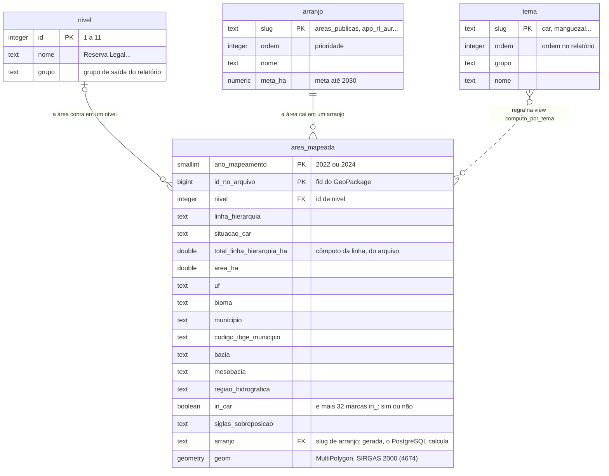
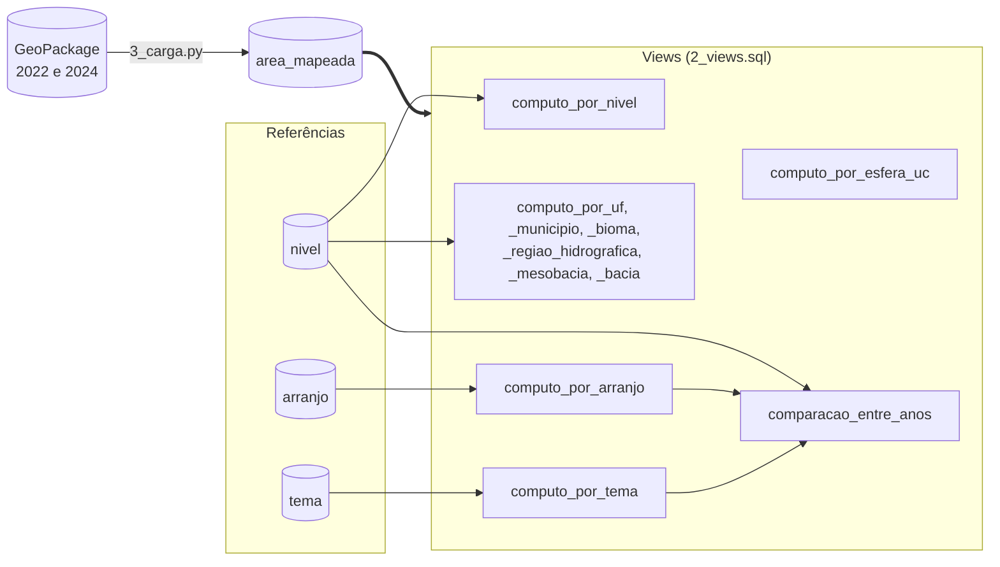
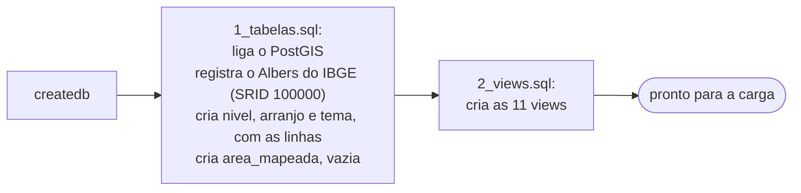
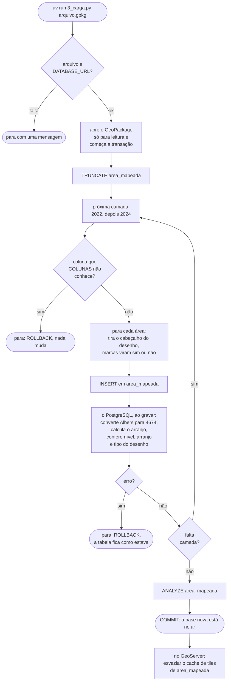
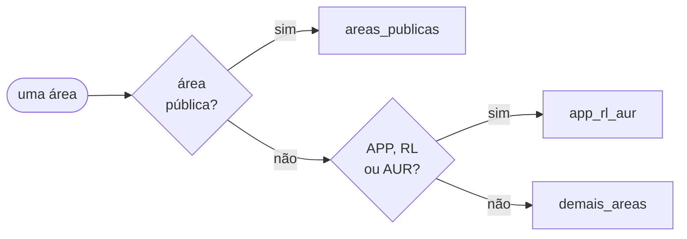

# Diagramas da modelagem nova

Os diagramas estão em Mermaid: o GitHub e o VS Code (com a extensão de Markdown com Mermaid) os
desenham sozinhos. O texto que explica cada peça está no [README](README.md).

## 1. Diagrama lógico: as tabelas

Quatro tabelas. `area_mapeada` tem uma linha por área do GeoPackage; `nivel`, `arranjo` e `tema`
são as referências, com uma linha por nível, arranjo e tema.

- **Linha cheia** é chave estrangeira: o banco só aceita em `area_mapeada.nivel` um `id` que
  exista em `nivel`, e em `area_mapeada.arranjo` um `slug` que exista em `arranjo`.
- **Linha tracejada** (`tema`) não é chave estrangeira: uma área pode estar em vários temas, e quem
  diz em quais é a regra da view `computo_por_tema`.
- **A chave de `area_mapeada`** é o par `(ano_mapeamento, id_no_arquivo)`: o mesmo `fid` existe nas
  duas camadas do arquivo.

## 2. De onde cada view lê

As onze views não guardam nada: leem as tabelas na hora. Todas leem `area_mapeada` (a seta
grossa); as setas finas mostram o que cada uma lê além dela.

O GeoServer publica `area_mapeada` como mapa (WMS) e as views, `nivel`, `arranjo` e `tema` como
tabelas (WFS).

## 3. Fluxograma: montar o banco (uma vez)

## 4. Fluxograma: a carga (a cada GeoPackage novo)

Tudo entre o começo da transação e o `COMMIT` é uma transação só: se der erro em qualquer ponto, o
banco desfaz tudo (`ROLLBACK`) e a tabela fica com a carga anterior.

## 5. A regra do arranjo

O arranjo de cada área é o primeiro que ela atende, na ordem de prioridade. É a coluna gerada
`arranjo` de `area_mapeada` (`1_tabelas.sql`).

- **Área pública:** nível 6, 7 ou 8 (Terras Indígenas, Unidades de Conservação, Sistemas
  Costeiros), ou está em UC, RPPN, Terra Indígena, assentamento ou território quilombola. A UC aqui
  é a sigla `UC` de `siglas_sobreposicao`, que não conta APA; não é a marca `in_uc` (veja
  "Cuidados" no README).
- **APP, RL ou AUR:** nível 3, 9, 10 ou 11 (PRADA, APP, AUR, Reserva Legal), ou está em APP, RL ou
  AUR de imóvel do CAR (habilitado, analisado ou não analisado), ou em imóvel do CAR em
  regularização.

O arranjo `baixa_produtividade` existe na tabela `arranjo`, mas a regra não manda nenhuma área para
ele: nas views, ele aparece com zero.
